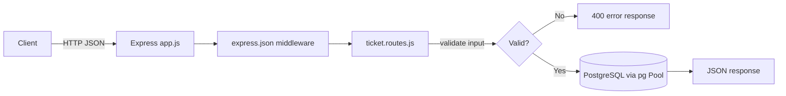
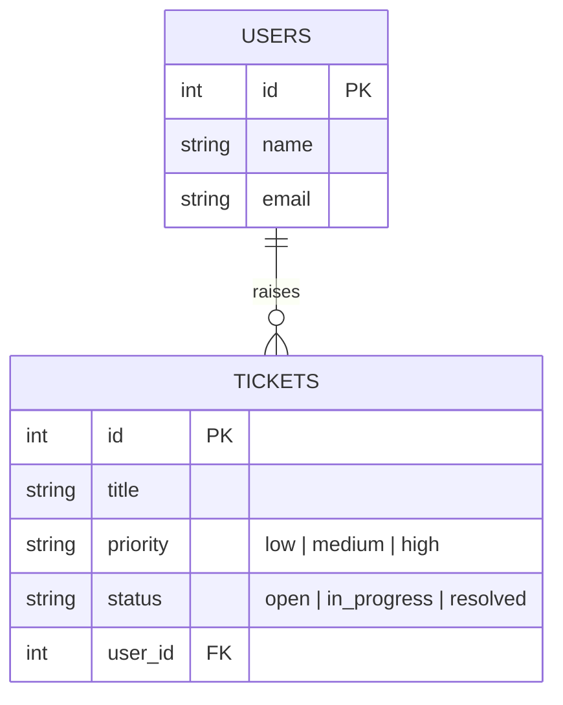

<div align="center">

# 🎫 DevDesk Backend

**A clean, validated RESTful API for managing support tickets.**
Built with Node.js, Express 5, and PostgreSQL.

<p>
  
  
  
  
</p>

<p>
  
  
  
</p>

[Features](#-features) · [Quick Start](#-quick-start) · [API Reference](#-api-reference) · [Database](#-database-schema) · [Roadmap](#-roadmap)

</div>

---

## 📖 Overview

**DevDesk** is a helpdesk-style backend where users raise support tickets and the team tracks them from `open` to `resolved`.

It is intentionally small and readable, with a focus on backend fundamentals done properly:

- Parameterized SQL queries (no string concatenation, so no SQL injection)
- Strict input validation with meaningful HTTP status codes
- A consistent JSON response shape across every endpoint
- Database errors (e.g. foreign key violations) translated into friendly API errors
- Fail-fast startup: the server refuses to boot if the database is unreachable

## ✨ Features

| | Feature | Details |
| --- | --- | --- |
| 🎟️ | **Ticket CRUD** | Create, read, update, and delete tickets |
| 📄 | **Pagination** | `page` and `limit` query params (max 100 per page) |
| 🛡️ | **Validation** | IDs, titles, priorities, statuses, and user references are checked before touching the database |
| 🔗 | **Relational integrity** | Every ticket belongs to a user through a foreign key |
| 🚦 | **Proper status codes** | `200`, `201`, `400`, `404`, `409`, `500` used where they make sense |
| ❤️ | **Health check** | `GET /api/v1/health` for uptime monitoring |
| ⚙️ | **Env-based config** | Credentials and port live in `.env`, never in code |

## 🧰 Tech Stack

| Technology | Role |
| --- | --- |
| [Node.js](https://nodejs.org/) | JavaScript runtime (ES Modules) |
| [Express 5](https://expressjs.com/) | Web framework |
| [PostgreSQL](https://www.postgresql.org/) | Relational database |
| [node-postgres (`pg`)](https://node-postgres.com/) | PostgreSQL client with connection pooling |
| [dotenv](https://github.com/motdotla/dotenv) | Environment variable loading |
| [Nodemon](https://nodemon.io/) | Auto-restart in development |

## 🗂️ Project Structure

```text
devdesk-backend/
├── src/
│   ├── config/
│   │   └── database.js        # PostgreSQL connection pool
│   ├── data/
│   │   └── tickets.js         # Static sample data (early prototype, not used by the API)
│   ├── routes/
│   │   └── ticket.routes.js   # Ticket endpoints + validation
│   ├── app.js                 # Express app, middleware, route mounting
│   └── server.js              # Entry point: checks DB, then starts listening
├── .gitignore
├── package.json
└── package-lock.json
```

### How a request flows



## 🚀 Quick Start

### Prerequisites

- [Node.js](https://nodejs.org/) 18 or newer
- [PostgreSQL](https://www.postgresql.org/) running locally (or a remote instance)
- [Git](https://git-scm.com/)

### 1. Clone and install

```bash
git clone https://github.com/alfathalifdewa/devdesk-backend.git
cd devdesk-backend
npm install
```

### 2. Configure environment variables

Create a `.env` file in the project root:

```env
PORT=3000

DB_HOST=localhost
DB_PORT=5432
DB_NAME=devdesk
DB_USER=postgres
DB_PASSWORD=your_password
```

| Variable | Default | Description |
| --- | --- | --- |
| `PORT` | `3000` | Port the API listens on |
| `DB_HOST` | n/a | PostgreSQL host |
| `DB_PORT` | `5432` | PostgreSQL port |
| `DB_NAME` | n/a | Database name |
| `DB_USER` | n/a | Database user |
| `DB_PASSWORD` | n/a | Database password |

> `.env` is already in `.gitignore`, so your credentials will not be committed.

### 3. Create the database

```bash
createdb devdesk
psql -d devdesk
```

Then run the SQL from the [Database Schema](#-database-schema) section to create the `users` and `tickets` tables the API expects.

### 4. Run the server

```bash
npm run dev     # development, auto-reload with nodemon
npm start       # production
```

On success you should see:

```text
Database Connected: devdesk
Server is running on port 3000
```

Quick check:

```bash
curl http://localhost:3000/api/v1/health
```

## 🗄️ Database Schema

The API queries a `tickets` table that references a `users` table. The repository does not ship migrations yet, so here is a reference schema that matches what the code expects. Adjust the `users` columns to your needs, since the API only relies on `users.id`.

```sql
CREATE TABLE users (
  id         SERIAL PRIMARY KEY,
  name       VARCHAR(100) NOT NULL,
  email      VARCHAR(255) NOT NULL UNIQUE,
  created_at TIMESTAMPTZ  NOT NULL DEFAULT NOW()
);

CREATE TABLE tickets (
  id         SERIAL PRIMARY KEY,
  title      VARCHAR(255) NOT NULL,
  priority   VARCHAR(10)  NOT NULL CHECK (priority IN ('low', 'medium', 'high')),
  status     VARCHAR(20)  NOT NULL DEFAULT 'open'
             CHECK (status IN ('open', 'in_progress', 'resolved')),
  user_id    INTEGER      NOT NULL REFERENCES users(id),
  created_at TIMESTAMPTZ  NOT NULL DEFAULT NOW()
);

-- Seed a user so you can create tickets right away
INSERT INTO users (name, email) VALUES ('Demo User', 'demo@example.com');
```



## 📡 API Reference

**Base URL:** `http://localhost:3000/api/v1`

| Method | Endpoint | Description |
| --- | --- | --- |
| `GET` | `/health` | Check that the API is running |
| `GET` | `/tickets` | List tickets (paginated) |
| `GET` | `/tickets/:id` | Get a single ticket |
| `POST` | `/tickets` | Create a ticket |
| `PUT` | `/tickets/:id` | Update a ticket |
| `DELETE` | `/tickets/:id` | Delete a ticket |

### ❤️ Health check

```bash
curl http://localhost:3000/api/v1/health
```

```json
{
  "success": true,
  "message": "DevDesk API is running"
}
```

### 📋 List tickets

```http
GET /api/v1/tickets?page=1&limit=10
```

| Query param | Default | Rules |
| --- | --- | --- |
| `page` | `1` | Positive integer |
| `limit` | `10` | Integer from 1 to 100 |

Results are ordered by `id` ascending.

```bash
curl "http://localhost:3000/api/v1/tickets?page=1&limit=5"
```

```json
{
  "success": true,
  "message": "Tickets retrieved successfully",
  "data": [
    {
      "id": 1,
      "title": "Unable to access dashboard",
      "priority": "high",
      "status": "open",
      "user_id": 1
    }
  ]
}
```

### 🔍 Get a ticket

```bash
curl http://localhost:3000/api/v1/tickets/1
```

Returns the ticket in `data`, or `404` if it does not exist.

### ➕ Create a ticket

```http
POST /api/v1/tickets
Content-Type: application/json
```

| Field | Type | Required | Rules |
| --- | --- | --- | --- |
| `title` | string | ✅ | Non-empty (whitespace is trimmed) |
| `priority` | string | ✅ | `low`, `medium`, or `high` |
| `user_id` | integer | ✅ | Positive integer of an existing user |

```bash
curl -X POST http://localhost:3000/api/v1/tickets \
  -H "Content-Type: application/json" \
  -d '{"title": "Unable to access dashboard", "priority": "high", "user_id": 1}'
```

Returns `201 Created` with the new ticket in `data`. The ticket's `status` comes from the database default (`open` in the reference schema).

### ✏️ Update a ticket

```http
PUT /api/v1/tickets/1
Content-Type: application/json
```

All three fields are required (this is a full update, not a partial one).

| Field | Type | Rules |
| --- | --- | --- |
| `title` | string | Non-empty |
| `priority` | string | `low`, `medium`, or `high` |
| `status` | string | `open`, `in_progress`, or `resolved` |

```bash
curl -X PUT http://localhost:3000/api/v1/tickets/1 \
  -H "Content-Type: application/json" \
  -d '{"title": "Dashboard access issue", "priority": "medium", "status": "in_progress"}'
```

### 🗑️ Delete a ticket

```bash
curl -X DELETE http://localhost:3000/api/v1/tickets/1
```

Returns the deleted ticket in `data`.

## 📦 Response Format

Every endpoint returns the same envelope.

**Success**

```json
{
  "success": true,
  "message": "Ticket retrieved successfully",
  "data": {
    "id": 1,
    "title": "Unable to access dashboard",
    "priority": "high",
    "status": "open",
    "user_id": 1
  }
}
```

**Error**

```json
{
  "success": false,
  "message": "Ticket not found"
}
```

### Status codes

| Code | Meaning | When it happens |
| --- | --- | --- |
| `200` | OK | Successful read, update, or delete |
| `201` | Created | Ticket created |
| `400` | Bad Request | Invalid ID, page, limit, title, priority, status, or a non-existent `user_id` |
| `404` | Not Found | Ticket does not exist |
| `409` | Conflict | Ticket cannot be deleted because other records reference it |
| `500` | Server Error | Unexpected database or server failure |

## 🎯 What This Project Demonstrates

- RESTful API design and correct use of HTTP methods and status codes
- Relational modeling with foreign keys, and handling constraint errors (`23503`)
- Safe, parameterized SQL with `pg`
- Input validation and offset-based pagination
- Async/await error handling in Express 5
- Fail-fast startup with a database connectivity check

## 🗺️ Roadmap

- [ ] User authentication and authorization (JWT)
- [ ] Role-based access control (user vs. agent/admin)
- [ ] Filtering, searching, and sorting tickets
- [ ] Pagination metadata (`total`, `totalPages`, `hasNext`)
- [ ] Validation middleware and centralized error handler
- [ ] Database migrations (e.g. `node-pg-migrate`)
- [ ] Automated tests (Vitest/Jest + Supertest)
- [ ] OpenAPI / Swagger documentation
- [ ] Soft delete
- [ ] Docker setup and deployment config

## 👤 Author

**Alfathalif Dewa Listyoka**, Backend Developer Enthusiast

[](https://github.com/alfathalifdewa)
[](https://alfathalifdewa.netlify.app)

---

<div align="center">
  <sub>Built with Node.js, Express, and PostgreSQL.</sub><br />
  <sub>Learning, building, and improving one API at a time. ⭐ A star is appreciated if this helped you!</sub>
</div>
